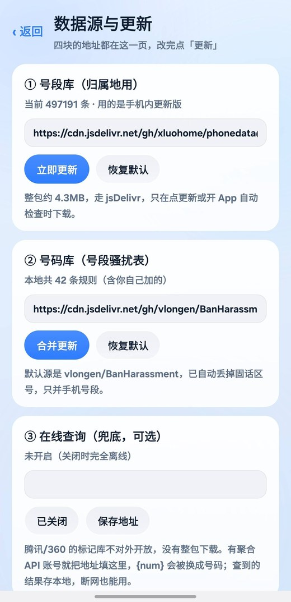
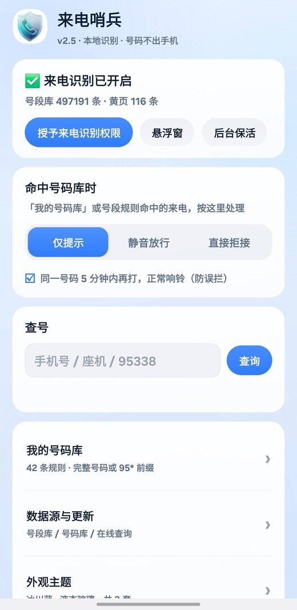

# 来电哨兵（CallerSentry）

给**非国行 / 类原生安卓**（Pixel、港版三星等）补上"来电归属地 + 号码库拦截"的轻量工具。
思路参考 [Pixel Telo](https://github.com/Pixel-Tailor-CN/PixelTelo)：**本地库优先，联网只做更新和兜底**。

- 纯 Java，**不依赖 Gradle、AndroidX、Kotlin**，用 `aapt2 + javac + d8 + apksigner` 手工构建
- APK 约 1.4 MB（号段库另 4.3 MB，构建时下载）
- 最低 Android 8.0（API 26），targetSdk 34
- 号码不出手机：除"更新库"和可选的在线兜底查询外，不发任何请求

> **三星 / One UI 用户请先看这里**：在这类机型上，「来电显示和骚扰拦截」角色是**失效**的——
> 系统不会把来电交给第三方。请直接用首页的**兼容模式**开关，详见
> [在三星 One UI 上的实际情况](#在三星-one-ui-上的实际情况)。

<p align="center"></p>

<p align="center">
  作者 <a href="https://github.com/fzj6394">@fzj6394</a> · 许可 GPL-3.0 · 欢迎提 issue / PR
</p>

## 界面

<p align="center">
  
  &nbsp;&nbsp;
  
</p>

| 首页 | 数据源与更新 |
|---|---|
| 授权状态、三档处理、查号、四个入口 | 号段库 / 号码库 / 在线查询 / 黄页，地址都在这一页 |
| 号段库 497,191 条 · 黄页 116 条 | 每块独立更新，可恢复默认 |

> 截图是 v2.5 时拍的。之后的版本加了**兼容模式开关**（首页第二行）、**来电悬浮条**、
> **号码标记**和**诊断页的运行日志**，界面结构没变，只是内容更满了。

界面用 `Ui` / `UiTheme` 纯代码构建（没有 layout XML、没有 AndroidX）：渐变底 + 三处柔光斑 + 半透明玻璃卡片 + 1dp 亮边 + 投影，三套主题（冰川蓝 / 晨雾白 / 暗夜灰）随时切换。

## 在三星 One UI 上的实际情况

这是本项目最花时间的一段，结论是**反直觉**的，先写在这里，省得你重复踩。

**「来电显示和骚扰拦截」这个角色，在港版三星（One UI 9 / Android 17，SM-S9360）上是空转的。**

判断依据全部来自 App 内的诊断页：

| 观测项 | 结果 |
|---|---|
| `RoleManager.isRoleHeld(ROLE_CALL_SCREENING)` | `true`（系统"默认应用"里也确实能选到本应用） |
| `PackageManager.getComponentEnabledSetting()` | 启用 |
| `queryIntentServices("android.telecom.CallScreeningService")` | 能列出本应用 |
| 真来电后 `ScreeningService.onCreate` / `onScreenCall` | **一次都没触发**（绑定计数 0、调用计数 0） |

原因：那份可发现的拦截服务列表里，除了本应用，还有三星拨号器自带的
`com.samsung.android.dialer` 实现。One UI 把来电先交给它，第三方持有的角色被忽略。
而电话 App → 设置 → 来电显示和骚扰拦截里**没有第三方选项**——系统"默认应用"和
三星自己那层设置是两套东西，不同步。

**所以：不要在这类机型上依赖拦截角色。** 走兼容模式。

### 兼容模式怎么工作

- 前台服务（`foregroundServiceType="specialUse"`）常驻，监听 `android.intent.action.PHONE_STATE`
- 响铃瞬间读 `EXTRA_INCOMING_NUMBER`（需要「电话」+「通话记录」两个权限），
  查号段库算归属地，弹悬浮条 + 发通知
- 完全绕开拦截角色；状态栏会多一条静默的常驻通知（前台服务的硬性要求）
- 覆盖安装会杀掉进程，所以每次打开 App 时会自动检查并补启动服务

代价说清楚：**只能提示，不能拒接、不能静音**。那两项能力属于拦截角色，拿不到。


## 功能

| 模块 | 说明 |
|---|---|
| 来电归属地 | 离线号段库（49.7 万条）二分查找，精确到市 + 运营商；支持固话区号、港澳台与国际区号 |
| 来电提示 | 液态玻璃悬浮条（`TYPE_APPLICATION_OVERLAY`）+ 通知栏双通道，从响铃显示到接听/挂断 |
| **兼容模式** | 不依赖拦截角色：前台服务监听 `PHONE_STATE`，响铃即提示。三星等机型用这个 |
| 三档处理 | 仅提示 / 静音放行 / 直接拒接（`CallScreeningService`，仅拦截角色可用时生效） |
| 号码标记 | 快递 / 外卖 / 广告推销 / 骚扰诈骗 / 正常，下次来电直接显示，优先级压过黄页与内置规则 |
| 重复来电放行 | 同一号码 5 分钟内再打，正常响铃（防误拦） |
| 我的号码库 | 完整号码全等 + `95*` 前缀匹配，导入导出 |
| 内置黄页 | 116 条客服短号（快递 / 航空 / 银行 / 保险 / 运营商 / 政务 / 紧急），SQLite 存储、内存查询 |
| 联网更新 | 号段库整包替换、号码库合并、黄页合并，均支持自定义 URL；也可从文件导入 |
| 在线兜底查询 | 可配置 URL 模板（`{num}` 占位），结果缓存本地，断网可用，失败一律放行 |
| 三套主题 | 液态玻璃风格：冰川蓝 / 晨雾白 / 暗夜灰 |
| 自我诊断 | 崩溃堆栈落盘 + 界面可分享；来电链路全链路运行日志（进入服务 / 判定 / respond / addView 结果 / 通知是否发出）；每通电话的分段耗时 |

## 快速开始（Windows + Git Bash）

### 1. 准备工具链

需要三样东西，任选安装方式：

| 组件 | 用途 |
|---|---|
| JDK 17 | `javac` / `java` / `keytool` / 运行 `d8` |
| Android SDK Build-Tools 34.0.0 | `aapt2` / `d8` / `zipalign` / `apksigner` |
| Android SDK Platform 34（`android.jar`） | 编译期的 `-bootclasspath` |

本项目不依赖 Gradle，只要能找到上面这些可执行文件即可。

`build.sh` 的路径是**自动推导**的：脚本所在的上一级当作工程根目录，工具链默认找根目录下的
`build-env/`。工具链装在别处时，用这三个环境变量覆盖，不用改脚本：

```bash
export SENTRY_ENV='D:/android-tools'                    # 工具链根目录
export ANDROID_BT="$SENTRY_ENV/sdk/build-tools/34.0.0"  # 可选，单独指定 build-tools
export ANDROID_PLATFORM="$SENTRY_ENV/sdk/platforms/android-34/android.jar"
export SENTRY_JDK='D:/jdk-17'                           # 可选，单独指定 JDK
```

### 2. 下载号段库

仓库里**不含** `assets/phone.dat`（4.3 MB，GPL-3.0 第三方数据），构建前跑一次：

```bash
bash tools/fetch-data.sh
```

### 3. 配置签名

签名密钥和口令都**不进仓库**。第一次构建会自动生成密钥，口令从环境变量或 `keystore/pass.txt` 读取：

```bash
# 方式一：环境变量
export SENTRY_KS_PASS='你的口令'

# 方式二：写文件（已在 .gitignore 中）
printf '你的口令' > keystore/pass.txt
```

> 升级安装必须用同一个密钥，**密钥或口令丢了就只能卸载重装**。

### 4. 构建

```bash
bash build.sh
```

成功会打印 `28 个类全部生成`，产物是根目录的 `CallerSentry.apk`。中间文件在 `build/out-<时间戳>/`，每次构建用新目录，不做批量删除。
编译失败会直接退出并打印 javac 错误——**不要**把它改成 `|| true`，之前吃过这个亏（打出了缺类的包，一启动就闪退）。

## 目录结构

```
caller-sentry/
├── AndroidManifest.xml
├── build.sh                  手工构建脚本
├── src/cn/fzj/callersentry/  28 个类
│   ├── App.java              崩溃捕获 + 预热
│   ├── MainActivity.java     首页
│   ├── RulesActivity.java    我的号码库
│   ├── SourcesActivity.java  数据源与更新（二级页面）
│   ├── AppearanceActivity.java  主题
│   ├── RecordsActivity.java  记录 / 耗时 / 诊断
│   ├── ScreeningService.java 来电判定与拦截（拦截角色路径）
│   ├── Watcher.java          兼容模式前台服务（监听 PHONE_STATE）
│   ├── Boot.java             开机/覆盖安装后拉服务
│   ├── Overlay / Notify.java 悬浮条（液态玻璃）与通知
│   ├── Trace / Timing.java   运行日志与分段耗时
│   ├── Tags.java             号码标签（快递/外卖/广告…）
│   ├── CallerIdProvider.java Directory Provider（通话记录可见性的尝试）
│   ├── PhoneLookup.java      号段库（二分）
│   ├── YellowStore.java      黄页（SQLite + 内存）
│   ├── Blacklist.java        号码库规则
│   ├── MarkCache / OnlineLookup / Update / Timing / LogStore
│   ├── Prefs.java            设置（内存快照）
│   └── Ui / UiTheme / Overlay / NumUtil / BasePageActivity
├── res/                      无 layout XML，界面全部代码构建
├── assets/yellow.txt         内置黄页（116 条）
├── test/                     JVM 单元测试（查表 / 解析）
└── tools/fetch-data.sh       下载号段库
```

## 测试

不需要设备，直接跑 JVM 测试（用 `android.jar` 当 classpath）：

```bash
JB="path/to/jdk/bin"; PL="path/to/android-34/android.jar"
"$JB/javac" -encoding UTF-8 -cp "$PL;build/out-*/classes" -d build/test test/TestLookup.java
"$JB/java" -cp "build/test;build/out-*/classes" TestLookup assets/phone.dat   # 16 个用例
```

## 数据来源与许可

| 数据 | 来源 | 许可 |
|---|---|---|
| 归属地号段库 `phone.dat` | [xluohome/phonedata](https://github.com/xluohome/phonedata) | **GPL-3.0** |
| 骚扰号段（运行时下载，不内置） | [vlongen/BanHarassment](https://github.com/vlongen/BanHarassment) | 见其仓库 |
| 内置黄页 116 条 | 政府公示与运营商/企业公开客服号（陕西/天津邮政管理局、民航局投诉公示等） | 公开信息，手工整理 |

因为内置依赖了 GPL-3.0 的数据，**本项目整体以 GPL-3.0 发布**（见 `LICENSE`）。
如果你希望改用 MIT，需要把 `phone.dat` 从分发物里去掉、改为用户自行导入——代码层面 `PhoneLookup` 已经支持从 `filesDir` 读取。

## 隐私

- 没有申请 `INTERNET` 之外的任何网络相关权限；联网只用于下载你指定的库和可选的兜底查询
- 不上传联系人、通话记录、号码
- 在线兜底查询默认**关闭**，开启后也只会把当前来电号码发给你自己填的地址
- `READ_CALL_LOG` 只用于两件事：Directory Provider（让拨号器能查名字）、以及「从通话记录里选号码打标签」。不读取通话内容
- **不申请任何通讯录权限**（曾试过写联系人让通话记录显示名字，v2.6.7 实现、v2.6.8 移除，因为会污染通讯录）

## 已知限制

- **三星不派发拦截角色，也不查第三方 Directory**：通话记录里只有裸号码，且无法拒接/静音。已在真机验证，不是配置错误，见[上文](#在三星-one-ui-上的实际情况)。
- 往 10086、95338 这类号码**拨出去**不会显示名字：`CallScreeningService` 只筛来电，系统不给我们外拨事件。
- 归属地靠号段推断，只精确到市；携号转网后运营商可能不准。
- 快递员、中介的**个人手机号**无法离线识别，只能靠在线兜底或自己标记。
- 三星需把 App 电池设为「不受限制」，否则前台服务会被杀（App 内有引导按钮）
- 兼容模式下「命中号码库」的拒接/静音档位无效，只能提示

## 致谢

这个项目是站在一堆别人铺好的路上做的，没有它们根本起不来。

### 开源项目

| 作者 | 项目 | 用在了哪 |
|---|---|---|
| [@xluohome](https://github.com/xluohome) | [phonedata](https://github.com/xluohome/phonedata) | 核心的归属地号段库，49.7 万条，`PhoneLookup` 的解析格式与二分索引都按它的结构实现 |
| [@vlongen](https://github.com/vlongen) | [BanHarassment](https://github.com/vlongen/BanHarassment) | 国内骚扰号段数据集，作为「号码库」的默认更新源 |
| [@Pixel-Tailor-CN](https://github.com/Pixel-Tailor-CN) | [Pixel Telo](https://github.com/Pixel-Tailor-CN/PixelTelo) | **设计蓝本**：本地库优先 + 联网兜底、三档处理（仅提示/静音/拒接）、重复来电放行、`CallScreeningService` 的角色适配，以及 Directory Provider 的用法，都是从这个项目学来的 |
| [@jhonsu01](https://github.com/jhonsu01) | [OpenCallShield](https://github.com/jhonsu01/OpenCallShield) | 公开号码列表的 JSON 结构（`{number, tag}`）与"规则引擎 + 定期同步"的思路参考 |
| [@xdtianyu](https://github.com/xdtianyu) | [PhoneNumber](https://github.com/xdtianyu/PhoneNumber) | 早期调研时参考了它的号码模型（归属地 / 标记 / 常用号码分层） |

### 数据与公开信息

- 快递客服号：陕西省邮政管理局、天津市政务网的寄递企业客服公示
- 航空公司客服号：民航局服务质量监督投诉公示（12326）、武汉市交通运输局、襄阳机场公告
- 黄页分类整理：公开的"常用电话"页面（sojson、查号吧等）

### 关于呼叫角色

特别感谢 AOSP 与 Google 的 `CallScreeningService` / `ContactsContract.Directory` / `TelephonyManager` 文档。
虽然三星既不给第三方派发拦截角色、也不查第三方目录，但 Android 至少留了
`PHONE_STATE` 广播这条能拿到号码的通道——兼容模式就是建立在它上面的。

## 版权与许可

```
Copyright (C) 2026 冯志佳 <https://github.com/fzj6394>
```

本项目（源码 + 内置黄页 `assets/yellow.txt`）以 **GPL-3.0** 发布，全文见 [LICENSE](LICENSE)。

`LICENSE` 保持 GPL 原文未做任何改动——加版权头会让 GitHub 的协议识别退化成 `NOASSERTION`，所以版权声明放在这里。

第三方数据各自的版权归原作者：归属地号段库来自 [xluohome/phonedata](https://github.com/xluohome/phonedata)（GPL-3.0），骚扰号段来自 [vlongen/BanHarassment](https://github.com/vlongen/BanHarassment)。

## 更新日志

- **v2.6.8** 移除 v2.6.7 的"写通讯录"尝试（代价是通讯录被塞满，不划算），通讯录权限一并去掉
- **v2.6.6** 标记改为从通话记录选号码，记录行加「标记」按钮，不用手打
- **v2.6.5** 号码标签（快递/外卖/广告/骚扰/正常）；提示条文案统一为「疑似骚扰电话」
- **v2.6.4** 悬浮条改液态玻璃，从响铃显示到接听/挂断才消失
- **v2.6.2** 悬浮条下移到屏幕 38% 处——原来 120dp 正好被三星来电卡片盖住，`addView` 成功却看不见
- **v2.6.1** **兼容模式**：前台服务监听 `PHONE_STATE`，绕开失效的拦截角色
- **v2.6.0** 日志加「写入自检」与页面心跳，区分"没调用"和"日志没写进"
- **v2.5.9** `Trace` 运行日志：全链路埋点，被吞掉的异常不再无声
- **v2.5.4~v2.5.8** 服务状态诊断：拦截角色 / 后台限制 / 绑定次数 / 调用次数 / 来电方向

- **v2.5** 黄页扩到 116 条（航空 25 / 快递 18 / 国际快递 4），加种子版本号让老用户自动补导
- **v2.4** 黄页转 SQLite（内存热缓存）、黄页热更新、电池保活引导、签名口令移出代码
- **v2.3** 来电延迟优化：无锁 `peek()`、设置内存快照、日志异步、悬浮条先显示后补字、内置耗时统计
- **v2.2** Directory Provider（通话记录可见性尝试）
- **v2.1** 顺序改为"本地判定 → 立刻 respond → 再算归属地"
- **v2.0** 液态玻璃 UI、三套主题、新图标、数据源收进二级页面
- **v1.5** 内置黄页 79 条
- **v1.0** 首个可用版本
